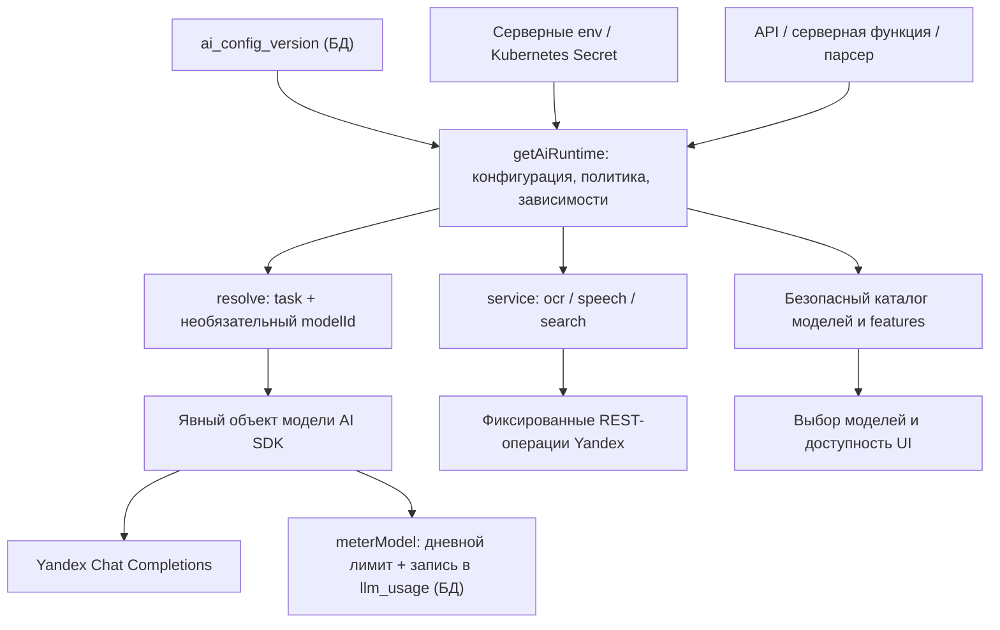
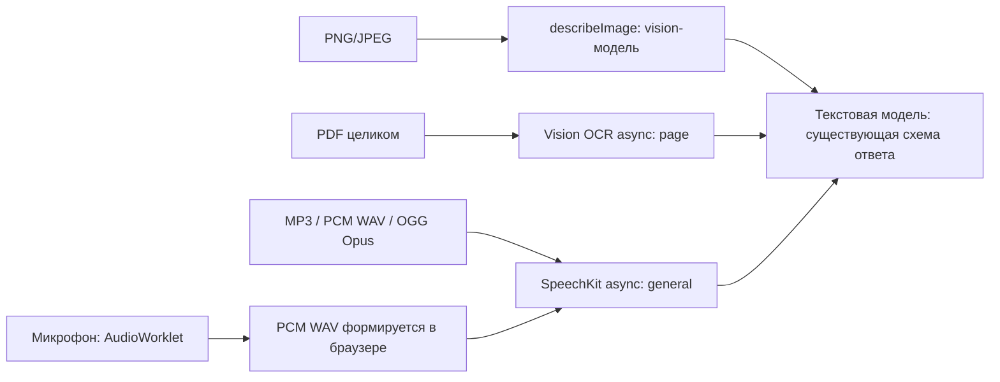

# Архитектура AI-подсистемы и карта кода

Состояние кода на 9 ноября 2026 года; 11 ноября — только Yandex, схема конфигурации версии 2 ([config-in-db-spec.md](config-in-db-spec.md), этап 1); учёт использования и цены моделей добавлены 11 ноября 2026 года — см. [metering-and-billing.md](metering-and-billing.md). Документ описывает реализацию после этапов 1–3 миграции; для понимания не требуется история Git. Наличие реализации не означает прохождение реальной приёмки или включение в production. Фактические проверки и отключения ведутся в [roadmap.md](roadmap.md).

## С чего начать чтение

1. [config-in-db-spec.md](config-in-db-spec.md) — где хранится конфигурация (таблица `ai_config_version`) и как её меняют («Настройки → Модели → Маршруты ИИ»).
2. [config.ts](../../src/server/ai/config.ts) — схема JSON, список задач, возможностей и проверка зависимостей.
3. [resolve.ts](../../src/server/ai/resolve.ts) — создание runtime, выбор модели и доступ к сервисам.
4. [policy.ts](../../src/server/ai/policy.ts) и [registry.ts](../../src/server/ai/registry.ts) — запреты и обязательные возможности моделей.
5. [adapters/yandex.ts](../../src/server/ai/adapters/yandex.ts) и [services.ts](../../src/server/ai/services.ts) — реальные сетевые обращения.
6. Найти свою функцию в таблице «Точки входа приложения» ниже и проследовать к её обработчику.
7. [metering-and-billing.md](metering-and-billing.md) — учёт каждого вызова модели в `llm_usage`, дневной лимит расходов, реестр цен `llm_model_price` и ежедневная синхронизация цен с Yandex Billing API.
8. [config-in-db-spec.md](config-in-db-spec.md) — согласованная спецификация: только Yandex, конфигурация маршрутов в БД вместо JSON (к реализации).

Основной серверный код находится в `src/server/ai/`. Прикладные промпты, схемы ответа и бизнес-логика остаются в вызывающих обработчиках и парсерах. AI runtime управляет доступностью и маршрутом, а не заменяет бизнес-логику, авторизацию пользователя или изоляцию организаций.

## Общая схема

Есть два разных способа обращения:

- **Модели генерации**: `runtime.resolve({ task, modelId? })` возвращает объект модели для `generateText` / `streamText`. Текст и изображения идут через адаптер AI SDK.
- **Специализированные сервисы**: `runtime.service("ocr" | "speech" | "search")` возвращает REST-клиент. OCR/STT/поиск не являются моделями `generateText`; их результат при необходимости передаётся разрешённой текстовой модели.

Успешная настройка `yandex-text` сама по себе не включает OCR, SpeechKit или Search API.

## Конфигурация и запуск

| Элемент JSON | Назначение |
| --- | --- |
Схема конфигурации — версия 2 (с 11 ноября 2026 года): только Yandex AI Studio. Раздела подключений нет: единственное подключение задано в коде ([yandex-connection.ts](../../src/server/ai/yandex-connection.ts)), адрес API — env `YANDEX_AI_API_URL` (по умолчанию `https://ai.api.cloud.yandex.net`, только https-origin без пути). Vercel AI Gateway и Google Search удалены. Спецификация: [config-in-db-spec.md](config-in-db-spec.md).

| Элемент JSON | Назначение |
| --- | --- |
| `version` | Всегда `2` |
| `features` | Переключатели веб-поиска, чтения сайтов и двух способов голосового ввода |
| `files` | `images`: `vision` (сначала `describeImage`) или `native` (inline-изображение сразу модели `parseImage`); `maxMediaSeconds`, `pdfMaxPages` |
| `services` | `ocr`, `speech`, `search`: вкл/выкл. Ключи — фиксированные env (`YANDEX_OCR_API_KEY`, `YANDEX_SPEECH_API_KEY`, `YANDEX_SEARCH_API_KEY`) |
| `models` | Внутренний ID, подпись, `uri` (необязательно), `capabilities` (`text`, `structuredOutput`, `tools`, `streaming`, `image`), `enabled` |
| `tasks` | Доступность прикладной задачи, `defaultModel`, `allowedModels`; автоматических fallback нет |

`yandex-text` и `yandex-vision` — внутренние ID конфигурации. URI модели (`gpt://<folder>/...`) — поле `uri`, обязательное для включённой модели. Клиент выбирает внутренний ID; переданный клиентом ID снова проверяется сервером.

[config.ts](../../src/server/ai/config.ts) использует строгую Zod-схему: неизвестные поля (в том числе старые `policy`, `connections`, `preprocessing`), битые ссылки, задачи без включённой модели и несогласованные зависимости отвергаются. Ошибки показывают пути полей без исходных значений. Зависимости: `parsePdf` требует `services.ocr`; `parseAudio` и серверный микрофон — `services.speech`; `webSearch` и `companyResearch` — `services.search`; `parseImage` при `images=vision` — включённый `describeImage`; `parseVideo` включить нельзя.

[registry.ts](../../src/server/ai/registry.ts) задаёт обязательные возможности задачи. Чат/аналитика требуют text/tools/streaming; поиск и исследование компании — text; `describeImage` — image; `parseImage` при `images=native` — structuredOutput + image; остальные — text + structuredOutput (PDF и аудио приходят модели текстом после OCR / SpeechKit). Нельзя ослабить эти требования параметрами вызова.

[resolve.ts](../../src/server/ai/resolve.ts) создаёт приватную копию конфигурации/env, адаптер Yandex и включённые сервисы. Проверяет адрес API, ключи, каталог, URI моделей и baseline-возможности задач **без сетевых запросов**. URI должен принадлежать каталогу `YANDEX_AI_FOLDER_ID`. Ключи/URI нужны для всех включённых моделей/сервисов, даже если конкретная задача ещё не запускалась. Если ничего не включено (`blocked.json`), env не нужны.

Откуда берётся конфигурация: [instrumentation.ts](../../src/instrumentation.ts) при запуске Node.js (кроме production build) вызывает `startAiConfigStore()` ([ai-config-store.ts](../../src/server/ai-config-store.ts)) и ждёт загрузки активной версии из таблицы `ai_config_version`. Нет версии, БД недоступна или версия неверна → AI выключен, остальная CRM работает. Каждые 30 с store проверяет активную версию и заменяет runtime без перезапуска pod. Правила выбора — [config-store.ts](../../src/server/ai/config-store.ts); runtime хранится на `globalThis` (`setAiRuntime` / `getAiRuntime` в `resolve.ts`). Версии редактирует админ платформы: «Настройки → Модели → Маршруты ИИ» ([admin-llm-routing.ts](../../src/server/admin-llm-routing.ts), [ai-routing.tsx](../../src/components/blocks/admin-llm-models/ai-routing.tsx)); загрузка из файла — `node --env-file=<env> tools/ai/run.mjs seed --input <file>` ([seed.ts](../../tools/ai/seed.ts)). Обе дороги проверяют документ одинаково ([config-document.ts](../../src/server/ai/config-document.ts)). JSON-файлов конфигурации в репозитории и на кластере больше нет (11 ноября 2026 года).

Тестовые документы (бывшие `config/ai/yandex.json` и `blocked.json`) — [tools/ai/fixtures.ts](../../tools/ai/fixtures.ts) и `DISABLED_AI_CONFIG` в `config.ts`.

## Модели и сетевой транспорт

| Файл | Ответственность |
| --- | --- |
| [index.ts](../../src/server/ai/index.ts) | Публичные серверные экспорты runtime, типов и ошибок политики |
| [adapters/yandex.ts](../../src/server/ai/adapters/yandex.ts) | OpenAI-compatible Chat Completions; авторизация `Api-Key`, `OpenAI-Project`, `x-data-logging-enabled: false`; проверка адреса и запрет редиректов |
| [yandex-connection.ts](../../src/server/ai/yandex-connection.ts) | Единственное подключение: адрес API из `YANDEX_AI_API_URL`, имена env ключей и каталога, переходные env URI моделей |
| [services.ts](../../src/server/ai/services.ts) | REST-клиент OCR/STT/Search, allowlist операций/адресов, авторизация, лимит чтения тела, безопасная сервисная ошибка |
| [errors.ts](../../src/server/ai/errors.ts) | Безопасные ошибки генерации/проб, классификация HTTP/сети/таймаутов, форматирование CLI |
| [diagnostics.ts](../../src/server/ai/diagnostics.ts) | Опциональная диагностика синтетических CLI-проб с маскированием ключей/полей авторизации и ограничением объёма |

Yandex-адаптер разрешает текст и явно включённые inline PNG/JPEG. Он запрещает прямые file-входы PDF/аудио/видео и URL файлов. Middleware предотвращает предварительное скачивание удалённых файлов самим AI SDK. Текстовая модель без image-capability не принимает изображения.

Для REST-сервисов задаются отдельные env ключей; автоматической подстановки AI-ключа нет. Каталог общий (`YANDEX_AI_FOLDER_ID`).

| Назначение | Реализованные адреса |
| --- | --- |
| Генерация | `<YANDEX_AI_API_URL>/v1/chat/completions` (по умолчанию `https://ai.api.cloud.yandex.net`) |
| PDF OCR | `<YANDEX_AI_API_URL>/ocr/v1/recognizeTextAsync`, `/ocr/v1/getRecognition?operationId=...` |
| SpeechKit | `https://stt.api.cloud.yandex.net/stt/v3/recognizeFileAsync`, `/stt/v3/getRecognition`, `/stt/v3/deleteRecognition` |
| Проверка операций OCR/STT | `https://operation.api.cloud.yandex.net/operations/<id>` |
| Веб-поиск | `https://searchapi.api.cloud.yandex.net/v2/web/search` |

Адреса специализированных сервисов и HTTP-методы определены в `services.ts`; редиректы запрещены. Для нового назначения нужно расширять транспорт и проверки, а не принимать URL от клиента. Другого провайдера в коде нет: ошибка Yandex не приводит к вызову другого API.

## Конвейеры файлов

| Файл | Что искать |
| --- | --- |
| [media.ts](../../src/server/ai/media.ts) | `prepareMediaInput`, `describeImage`, проверка PNG/JPEG; изображение — `vision` или `native` (inline PNG/JPEG), PDF — всегда OCR |
| [ocr.ts](../../src/server/ai/ocr.ts) | `recognizePdf`: исходный PDF Base64 → запуск async → polling → результат; `parseOcrResult`: страницы JSON/JSONL, нумерация, дубли, лимиты и пустой текст |
| [av.ts](../../src/server/ai/av.ts) | `prepareAvInput`, `transcribeMedia`, `speechContainer`, `pcmWavDuration`; прямые аудиобайты, проверка контейнеров и длительности; явный отказ видео |
| [speech.ts](../../src/server/ai/speech.ts) | `recognizeSpeech`: запуск/poll/result/delete; `parseSpeechResult` и `parseSpeechFileResult`: финальные/нормализованные реплики, таймкоды и полная длительность |
| [парсер изображения](../../src/server/parsers/image.ts) | Прикладная схема изображения, decorative-признак, frontmatter/Markdown и метаданные |
| [парсер PDF](../../src/server/parsers/pdf.ts) | Прикладная схема документа; текст OCR структурируется текстовой моделью |
| [парсер аудио](../../src/server/parsers/audio.ts) | Схема анализа, итоговый Markdown; транскрипт/таймкоды/длительность Yandex подставляются из STT, а не из догадок LLM |
| [парсер видео](../../src/server/parsers/video.ts) | Задача `parseVideo` не может быть включена; вызов отклоняется до обращения к модели |
| [_shared.ts](../../src/server/parsers/_shared.ts) | Общие схемы/типы метаданных, Markdown/frontmatter и `MetadataAnalysis.parserModel` |
| [parser-config.ts](../../src/lib/parser-config.ts) | Общие ограничения/форматы парсеров; маршруты моделей здесь не задаются |

В Yandex изображение читается vision-моделью, затем результат структурируется отдельной текстовой моделью. PDF использует **OCR текста**, не визуальный анализ фотографий/диаграмм. Для PDF vision URI не требуется. PDF/аудио передаются inline; Poppler, ffmpeg, ffprobe, server temp-файлы и локальная растеризация не используются.

OCR-проверка числа страниц происходит после обработки сервисом; для MP3/OGG ограничение полной длительности проверяется после STT. Превышение может быть оплачено провайдеру, хотя результат отвергается. Для PCM WAV длительность вычисляется до отправки. Ограничения и таймауты подробно перечислены в [stage-3-check.md](stage-3-check.md); при изменении лимита синхронно обновлять код, схему конфигурации и инструкцию.

Говорящие пока не идентифицируются: `Unknown`, `speakerCount=null` при наличии речи. Канал записи не выдаётся за человека. Нормализованный текст STT заменяет исходную гипотезу, сохраняя её таймкоды, если уточнение их не содержит. Полная длительность берётся из `receivedDataMs`, а не из конца последней реплики.

## Микрофон: браузер и сервер

| Файл | Назначение |
| --- | --- |
| [server-speech-input.tsx](../../src/components/blocks/server-speech-input.tsx) | Разрешение микрофона, AudioContext/AudioWorklet, старт/остановка/очистка, отправка WAV в собственный API и вставка текста в поле чата |
| [pcm-recorder.js](../../public/ai/pcm-recorder.js) | Браузерный AudioWorklet; PCM, смешивание каналов, передача блоков основному потоку, flush последнего блока; сетевых запросов нет |
| [pcm-wav.ts](../../src/lib/pcm-wav.ts) | Формирование mono PCM 16-bit WAV 16 kHz в браузере, без стороннего кодека |
| [POST /api/ai/transcribe](../../src/app/api/ai/transcribe/route.ts) | Сессия пользователя, проверка Origin/MIME/объёма потока, feature gate, вызов серверного распознавания, безопасный ответ |
| [voice.ts](../../src/server/ai/voice.ts) | Проверка PCM WAV/длительности и `serverSpeechRecognition`; один запрос на пользователя в процессе; общий SpeechKit-конвейер |

Микрофон зависит от feature и speech-сервиса; `tasks.parseAudio` отдельно включать не обязательно. Ручка требует входа, даже если другие поверхности чата допускают публичный доступ. Запись — до 90 секунд, сервер допускает до 91 секунды для завершения блока. Текст вставляется в поле ввода, автоматически сообщение не отправляется.

Worklet должен поставляться вместе с `public/` и быть доступен по `/ai/pcm-recorder.js`. Нужны HTTPS/поддержка AudioWorklet; при отказе нет fallback в браузерный SpeechRecognition. Проверять как минимум Chrome и Safari. Ограничение одновременных запросов локально для процесса, не является распределённым rate limiter.

## Поиск и исследование компаний

[search.ts](../../src/server/ai/search.ts) содержит `researchYandex`: проверяет feature, задачу и сервис; запрашивает до шести результатов Search API; разбирает Base64/XML; передаёт сниппеты текстовой модели без инструментов скачивания страниц. XML с DTD/entities отвергается. Возвращаемые `sources` берутся из результатов поиска, а не генерируются моделью. Это не гарантирует фактическую точность каждого предложения сводки.

[web-search.ts](../../src/server/web-search.ts) — функция инструмента `searchWeb` для чата. Вызывает только `researchYandex`. Без сервиса `search` задача `webSearch` выключена, и инструмент не регистрируется. Ошибка поиска возвращается как `grounded=false`, а не включает другого провайдера.

[clients.ts](../../src/server/clients.ts), `lookupClientOnWeb` — исследование компании и структурирование кандидатов. Сначала проверяет организацию/доступ к записи, затем маршруты `companyResearch` и `companyExtraction`. Без сервиса `search` исследование недоступно (ошибка политики). Поиск Yandex использует имя/известный сайт и поисковые слова; исследовательский контекст передаётся разрешённой модели. `fetchSiteTextForLookup` защищён отдельным `websiteFetch`; в целевом профиле прямое чтение сайтов выключено. Поэтому полнота обогащения по сниппетам может быть ниже.

## Каталог и интерфейс

[catalog.ts](../../src/server/ai/catalog.ts) и [GET /api/ai/config](../../src/app/api/ai/config/route.ts) публикуют внутренние ID, подписи, default, capabilities и features. Адресов, ключей, upstream URI и имён credential-env в выдаче нет. Каталог не является проверкой доступности API или прав пользователя на CRM-запись.

[use-ai-models.ts](../../src/hooks/use-ai-models.ts) получает каталог с `no-store` и выбирает доступную модель/default. Главные потребители:

- [ai-chat.tsx](../../src/components/blocks/ai-chat.tsx) — модели чата, доступность поиска/микрофона; вложения в чате выключены;
- [explore-sources-dialog.tsx](../../src/components/blocks/explore-sources-dialog.tsx), [magic-cards-button.tsx](../../src/components/blocks/magic-cards-button.tsx) — генерация карточек;
- [discover-deals-dialog.tsx](../../src/components/blocks/discover-deals-dialog.tsx), [magic-deals-button.tsx](../../src/components/blocks/magic-deals-button.tsx) — поиск сделок.

Сервер повторно проверяет выбор независимо от UI. Файлы в глобальном Yandex-чате пока запрещены, в том числе в истории сообщений; рабочие парсеры файлов Sources не означают поддержку вложений чата. Проверка сообщений — `assertChatContentAllowed` из `policy.ts`; Yandex-адаптер дополнительно проверяет файловые части модельного входа. Старый справочник `llm-models.ts` удалён 11 ноября 2026 года.

## Точки входа приложения

| Задача / функция | Куда смотреть |
| --- | --- |
| `chat` | [api/chat/route.ts](../../src/app/api/chat/route.ts); прикладной [chat-prompt.ts](../../src/lib/chat-prompt.ts) |
| `analytics` | [api/analytics/assistant/route.ts](../../src/app/api/analytics/assistant/route.ts); инструменты/семантика в [analytics-semantic.ts](../../src/server/analytics-semantic.ts) |
| `cards` | [cards-generation.ts](../../src/server/cards-generation.ts), `generateCards`; API [cards/generate](../../src/app/api/cards/generate/route.ts) |
| `deals` | [deals-discovery.ts](../../src/server/deals-discovery.ts); API [deals/discover](../../src/app/api/deals/discover/route.ts) |
| `orderRequest` | [order-requests.ts](../../src/server/order-requests.ts), LLM-разбор свободного текста заказа |
| `chatSummary` | [save-chat-session.ts](../../src/server/save-chat-session.ts), сохранение/анализ переписки и вложений |
| `companyResearch`, `companyExtraction` | [clients.ts](../../src/server/clients.ts), `lookupClientOnWeb`; Yandex-исследование в `ai/search.ts` |
| `parseText` | [text.ts](../../src/server/parsers/text.ts), [chat.ts](../../src/server/parsers/chat.ts), [telegram.ts](../../src/server/parsers/telegram.ts), [whatsapp.ts](../../src/server/parsers/whatsapp.ts), [drive.ts](../../src/server/parsers/drive.ts) |
| `parseOffice` | [office.ts](../../src/server/parsers/office.ts): существующее извлечение содержимого → разрешённая текстовая модель |
| `parseImage`, `describeImage`, `parsePdf`, `parseAudio`, `parseVideo` | Прикладные парсеры и конвейеры из раздела файлов выше |
| `orgAttribution` | [org-attribution.ts](../../src/server/parsers/org-attribution.ts); при ошибке предусмотрен детерминированный результат |
| `webSearch` | [web-search.ts](../../src/server/web-search.ts), [ai/search.ts](../../src/server/ai/search.ts) |
| Ручная загрузка | [parsers/dropoff.ts](../../src/server/parsers/dropoff.ts), API [sources/dropoff/upload](../../src/app/api/sources/dropoff/upload/route.ts) |
| Повторный/фоновый парсинг | [parse-source-item.ts](../../src/server/parse-source-item.ts); запуск из [orchestration](../../src/server/orchestration/daily-pipeline.ts) через общие парсеры |

Авторизация и org-scoping остаются в прикладном слое. Для новых запросов к БД использовать серверные функции, не добавлять ORM в API-маршруты.

Происхождение результатов хранится в `MetadataAnalysis.parserModel` → `source_item.parser_model`: для двухступенчатого разбора указывается цепочка сервиса/моделей, например `vision-ocr/page → gpt://...`. Сохранение выполняют `parse-source-item.ts`, `save-chat-session.ts` и upload-маршрут. Это метаданные происхождения, не полный журнал трассировки, стоимости или доказательство маршрута сетевого трафика.

## CLI, проверки и эксплуатация

| Файл | Назначение |
| --- | --- |
| [run.mjs](../../tools/ai/run.mjs) | Обёртка команд `check`, `test`, `seed`: компилирует ограниченный граф TypeScript во временный каталог и запускает Node с server-условиями; нативный tsx/esbuild не нужен |
| [seed.ts](../../tools/ai/seed.ts) | `seed`: проверяет JSON и env без сети, дописывает URI моделей из env, пишет активную версию в `ai_config_version` (`--dry-run`, `--replace`) |
| [check.ts](../../tools/ai/check.ts) | Проверка документа из файла (`--config`, обязательно) и runtime без сети либо явные платные синтетические пробы text/structured/tools/stream/image/pdf; env-файлы автоматически не загружает |
| [synthetic-media.ts](../../tools/ai/synthetic-media.ts) | PNG/PDF для проб без чтения пользовательских файлов |
| [runtime.test.ts](../../tools/ai/runtime.test.ts) | Политика, адаптеры, сервисы, mock HTTP, форматы файлов, ошибки/очистка, PCM/WAV и AudioWorklet |

`check --config <файл>` без `--probe` проверяет конфигурацию и наличие/формат активных env; успешный результат не подтверждает настоящий ключ, квоту или права. `--debug` относится к синтетическим модельным пробам; не включать подобный вывод содержимого для реальных CRM-запросов без отдельного решения.

Прикладной AI-код не использует локальные декодеры. Временный каталог у `tools/ai/run.mjs` нужен для компиляции CLI и не является предобработкой клиентских медиафайлов.

## Kubernetes и источник работающей конфигурации

- Конфигурация маршрутов — в БД (`ai_config_version`), не в манифестах. ConfigMap `crm-ai-config`, монтирование `/etc/crm-ai` и `AI_CONFIG_PATH` удалены из [deployment.yaml](../../deploy/k8s/app/deployment.yaml) и [kustomization.yaml](../../deploy/k8s/app/kustomization.yaml) 11 ноября 2026 года. Сам ConfigMap на кластере удаляет оператор (у `github-deployer` нет права на удаление).
- [deployment.yaml](../../deploy/k8s/app/deployment.yaml) получает env из Secret `crm-env`.
- [env.example](../../deploy/k8s/app/env.example) перечисляет переменные; значений секретов в репозитории быть не должно. Модели: `YANDEX_AI_API_KEY`, `YANDEX_AI_FOLDER_ID`, необязательный `YANDEX_AI_API_URL`; PDF — `YANDEX_OCR_API_KEY`, аудио/микрофон — `YANDEX_SPEECH_API_KEY`, поиск — `YANDEX_SEARCH_API_KEY`. URI моделей — в БД, не в env.
- [.github/workflows/dev.yml](../../.github/workflows/dev.yml) делает checkout ветки и `kubectl apply -k deploy/k8s/app`; Secret приложения не обновляет. Push в main собирает образ, deploy запускается вручную.
- Изменение кода требует нового образа. Изменение маршрутов — в UI, действует за ≤ 30 с без перезапуска. Изменение Secret требует rollout restart.

Пошаговые команды: [stage-3-check.md](stage-3-check.md), [ai-configuration.md](../deploy/ai-configuration.md), [local-run.md](../deploy/local-run.md). Развёртывание выполняет владелец окружения.

## Границы и дальнейшие изменения

Сейчас в целевом профиле отключены видео, неподдерживаемые STT контейнеры (M4A/WebM/FLAC/Vorbis), идентификация говорящих, прямое чтение сайтов, браузерный SpeechRecognition и файлы глобального чата. Причины/условия возврата — в [roadmap.md](roadmap.md), точные лимиты — в [stage-3-check.md](stage-3-check.md). Не восстанавливать отключённую функцию обходом resolver или неявным вызовом старого провайдера.

SpeechKit удаляет результат в `finally` после получения ID; аварийное завершение/потеря ответа старта не гарантируют удаление. Ошибка cleanup видна как безопасная ошибка с ID. Для OCR отдельное удаление результата не реализовано. Заголовок отключения логирования не равен гарантии отсутствия хранения. Регион, условия обработки/хранения и сетевые ограничения требуют проверки этапа 4; здесь описана программная маршрутизация. Почта, Google Drive/Chat, S3 и другие внешние интеграции CRM не заменяются этим AI-слоем.

При добавлении задачи: расширить `AI_TASKS`, baseline capabilities, конфигурацию и прикладной вызов через runtime. При добавлении REST-сервиса Yandex: разрешённые адреса/операции в `services.ts`, проверки политики и тесты отказов. Другой провайдер — только отдельным решением и ревью кода, не через конфигурацию. После изменения доступности обновить roadmap и эксплуатационную инструкцию. Простое изменение label/capabilities не доказывает поддержку функции моделью.

Связанные документы: [migration-plan.md](migration-plan.md) — решения и план; [current.md](current.md) — **историческая исходная инвентаризация**, а не текущая схема маршрутов; [stage-2-check.md](stage-2-check.md) — текстовые пробы; [roadmap.md](roadmap.md) — фактический прогресс и отключения.
