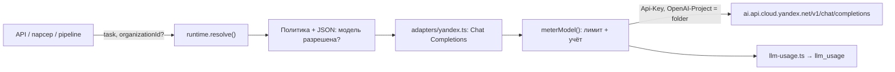

# Учёт использования, цены моделей и биллинг Yandex

Состояние кода на 11 ноября 2026 года (Topics, фаза 0). Общая архитектура AI-подсистемы: [architecture.md](architecture.md). Реестр переноса и проверок: [roadmap.md](roadmap.md).

## Кратко

| Что | Где хранится | Кто меняет |
| --- | --- | --- |
| **Реестр маршрутов**: подключения, модели (`yandex-text`, `yandex-vision`), задачи, разрешённые модели, сервисы OCR / STT / поиск | JSON по `AI_CONFIG_PATH` (на кластере — ConfigMap `crm-ai-config` из `deploy/k8s/app/ai-config.json`) | Разработчик, через изменение JSON и деплой |
| **Реестр цен моделей** (₽ за 1 000 токенов, с датой начала действия) | БД, таблица `llm_model_price` | Автоматически из Yandex Billing API раз в сутки; вручную — админ в «Настройки → Модели» |
| **Журнал вызовов** (одна строка на вызов модели) | БД, таблица `llm_usage` | Только приложение, автоматически |
| **Настройки платформы**: дневной лимит по умолчанию, наценка, связи моделей с позициями прайса Yandex, результат последней синхронизации цен | БД, таблица `platform_setting` (ключ → jsonb) | Админ в «Настройки → Модели»; синхронизация цен |
| **Настройки организации**: режим Topics, свой дневной лимит, системный пользователь Topics | БД, таблица `organization_settings` | Админ в «Настройки → Модели» |

Важно: БД **не заменяет** JSON-конфигурацию. JSON решает, какие модели и сервисы разрешены и куда идёт запрос. БД хранит, сколько это стоило и кто это использовал. Без `AI_CONFIG_PATH` приложение не запускается (см. [architecture.md](architecture.md)).

Таблицы созданы миграцией [0003_llm_usage_org_settings.sql](../../db/migrations/0003_llm_usage_org_settings.sql).

## Как вызов модели попадает к Yandex

1. Вызывающий код просит модель для задачи: `getAiRuntime().resolve({ task, organizationId?, sourceItemId? })`.
2. [resolve.ts](../../src/server/ai/resolve.ts) проверяет задачу и модель по JSON и политике, берёт URI модели из env (`YANDEX_AI_TEXT_MODEL_URI` и т. п.).
3. [adapters/yandex.ts](../../src/server/ai/adapters/yandex.ts) создаёт OpenAI-совместимую модель AI SDK:
   - адрес только `https://ai.api.cloud.yandex.net/v1/chat/completions`, редиректы запрещены;
   - заголовки `Authorization: Api-Key <YANDEX_AI_API_KEY>`, `OpenAI-Project: <YANDEX_AI_FOLDER_ID>`, `x-data-logging-enabled: false`;
   - URI модели обязан принадлежать каталогу (`gpt://<folder>/...`);
   - файлы — только inline PNG/JPEG до 10 МиБ и только для моделей с `image`.
4. `resolve()` оборачивает модель в [meterModel()](../../src/server/ai/usage.ts) (см. ниже). Это касается **каждого** `generateText` / `generateObject` / `streamText`.

OCR, SpeechKit и Search API вызываются через `runtime.service(...)` ([services.ts](../../src/server/ai/services.ts)). Они **не проходят** через `meterModel` и не пишутся в `llm_usage`.

## Учёт вызовов (`llm_usage`)

### Middleware

[src/server/ai/usage.ts](../../src/server/ai/usage.ts) — без обращений к БД:

- `meterModel(model, route, context)` оборачивает модель AI SDK. Для каждого вызова:
  1. до вызова — `sink.assertWithinBudget(...)`: при исчерпанном лимите бросает `AiBudgetError` (подкласс `AiPolicyError`, сообщение на русском), а отказ тоже записывается;
  2. после вызова — `sink.record(...)`: токены, задержка, успех, класс ошибки (`classifyAiError`).
  - Для стрима запись делается один раз, когда стрим закончился или оборвался.
- Организация и источник берутся:
  - из параметров `resolve({ organizationId, sourceItemId })` — чат, ассистент аналитики, карточки, сделки, заказ из запроса, итоги чата;
  - иначе из асинхронного контекста `withAiUsageContext({ organizationId, sourceItemId }, fn)`, который ставит точка входа — парсинг элемента источника (`parse-source-item.ts`), загрузки dropoff / WhatsApp, обогащение компаний (`clients.ts`), веб-поиск, сохранение переписки.
  - Контекст фиксируется в момент `resolve()`, поэтому поздно прочитанный стрим пишется на правильную организацию.
- `registerAiUsageSink(sink)` — sink хранится на `globalThis` (Next.js может загрузить модуль несколько раз). Без sink (CLI `tools/ai`, тесты) модель возвращается без обёртки и ничего не учитывается.
- `normalizeUpstreamModel()` убирает каталог: `gpt://<folder>/yandexgpt-5.1/latest` → `yandexgpt-5.1/latest`. Это имя — ключ цены в `llm_model_price` и колонка `llm_usage.model`.

### Запись в БД

[src/server/llm-usage.ts](../../src/server/llm-usage.ts) — `createDbUsageSink()`, регистрируется при старте Node.js в [instrumentation.ts](../../src/instrumentation.ts) (`registerLlmUsageSink()`).

Колонки `llm_usage`: `created_at`, `organization_id`, `task`, `model_id` (ID из JSON, например `yandex-text`), `model` (нормализованное upstream-имя), `operation` (`generate` | `stream`), `input_tokens`, `output_tokens`, `cost_rub`, `latency_ms`, `ok`, `error_class`, `source_item_id`.

- **Текст промпта и ответа не сохраняется.**
- `cost_rub` считается при INSERT: токены × последняя цена модели с `valid_from ≤ now()`. Нет цены → `cost_rub = NULL` (в UI «нет цены», в лимит не идёт).
- Ошибка записи не ломает вызов модели (пишется в лог).

### Дневной лимит расходов

- Лимит организации: `organization_settings.llm_daily_cap_rub`, иначе `platform_setting['llm.dailyCapRub']`, иначе 500 ₽.
- День — календарный день по Москве (`Europe/Moscow`).
- Лимит считается по **нашей себестоимости** (`cost_rub`), не по цене с наценкой.
- Вызовы без организации (системные) лимитом не ограничиваются.
- Лимит защищает от расходов, это не механизм безопасности: если проверка не смогла прочитать БД, вызов разрешается (fail open) и ошибка пишется в лог.
- Функции: `getOrgBudgetState(orgId)` (лимит, расход за сегодня, превышен ли), `isOrgOverDailyLlmBudget(orgId)` (пока не вызывается — для будущей фоновой обработки Topics).

## Цены моделей (`llm_model_price`)

Строка: `model`, `input_rub_per_1k`, `output_rub_per_1k`, `valid_from`, `created_by`. Уникальность — (`model`, `valid_from`). Цены не редактируются: новая цена — новая строка с новой датой, поэтому старые вызовы сохраняют свою стоимость.

- `created_by = NULL` — цена добавлена автоматически («авто (Yandex)» в UI).
- `created_by = <user id>` — цена введена админом вручную.

### Автоматическая синхронизация с Yandex Billing API

Код: [src/server/ai/billing.ts](../../src/server/ai/billing.ts) (чистые функции, без БД) и [src/server/llm-pricing.ts](../../src/server/llm-pricing.ts) (БД, расписание).

**Доступ.** Billing API не принимает API-ключ, нужен IAM-токен:

1. Сервисный аккаунт с ролью `billing.accounts.viewer` на платёжном аккаунте.
2. Авторизованный ключ этого аккаунта (JSON) → env `YANDEX_BILLING_SA_KEY` (JSON или base64 в одну строку); ID платёжного аккаунта → `YANDEX_BILLING_ACCOUNT_ID`.
3. Приложение подписывает JWT (PS256, `aud = https://iam.api.cloud.yandex.net/iam/v1/tokens`, срок 1 ч), меняет его на IAM-токен (`POST iam/v1/tokens`) и кэширует токен.
4. `GET https://billing.api.cloud.yandex.net/billing/v1/skus?currency=RUB&billingAccountId=…&filter=serviceId="dn2o984h40l32p7t5nsv"` (сервис AI Studio), постранично.

Обе переменные не заданы → синхронизация выключена, цены вводятся вручную. Задана только одна или ID неверного формата → ошибка настройки показывается в «Модели».

**Связь модели с прайсом (SKU).** Одна модель = две позиции прайса: входные и выходные токены.

- Встроенные связи — `DEFAULT_SKU_MAP` в `billing.ts` (`yandexgpt-5.1`, `qwen3.6-35b-a3b`, синхронный режим).
- Админ может выбрать другую позицию или выключить синхронизацию модели: `platform_setting['llm.priceSync.skuMap']` (`null` у модели = не синхронизировать).
- Список позиций для выбора строится из прайса: `groupTextGenerationSkus()` разбирает имена вида `Text generation, <model> model, input|output tokens, synchronous|asynchronous|batch mode`.

**Цена.** `skuPricePoints()` берёт базовый тариф; договорная цена платёжного аккаунта важнее публичной. Единицы (`token`, `1k*token`, `1m*token`) приводятся к ₽ за 1 000 токенов. `planModelPriceRows()` добавляет строку «сейчас», только если цена отличается от действующей, и строки для объявленных будущих изменений цены.

**Расписание.** Таймер в каждом процессе приложения (`startLlmPriceSyncSchedule()` из `instrumentation.ts`): первая проверка через 2 минуты после старта, далее каждые 6 часов. Синхронизация запускается, если последняя успешная была более 23 часов назад; неудачная повторяется на следующей проверке. Несколько реплик не создают дубли: транзакционная advisory-блокировка + проверка «цена изменилась» + уникальный индекс. Kubernetes CronJob для этого не нужен.

**Результат** последнего запуска — `platform_setting['llm.priceSync.lastRun']`: время, способ запуска (по расписанию / вручную), статус (`ok` | `partial` | `failed` | `not_configured`), добавленные цены, ошибки, модели без связи.

### Наценка для клиента

`platform_setting['llm.markupPercent']`, по умолчанию 50 %. Только отображение: «Для клиента, ₽» в «Использовании» и «Клиенту вход/выход» в «Моделях». На лимит и на `cost_rub` не влияет.

## Админка и API

Все маршруты — только для администратора платформы (`requirePlatformAdmin`), логика в [src/server/admin-llm.ts](../../src/server/admin-llm.ts).

| Маршрут | Методы | Назначение |
| --- | --- | --- |
| `/api/admin/llm/stats?from=&to=` | GET | Строки по (день МСК, организация, задача, модель): вызовы, ошибки, отказы по лимиту, токены, себестоимость, вызовы без цены, средняя / p95 задержка. Период до 92 дней |
| `/api/admin/llm/settings` | GET, PUT | Дневной лимит по умолчанию (`dailyCapRubDefault`), наценка (`markupPercent`, 0–1000) |
| `/api/admin/llm/orgs` | GET, PUT | По организациям: режим Topics, свой дневной лимит, расход за сегодня |
| `/api/admin/llm/prices` | GET, POST, DELETE `?id=` | Список цен, ручное добавление, удаление строки |
| `/api/admin/llm/price-sync` | GET, POST | Состояние синхронизации; POST — запустить сейчас |
| `/api/admin/llm/sku-links` | GET, PUT | Позиции прайса Yandex для выбора; связать модель с позицией или выключить синхронизацию |

UI — «Настройки» (`/settings`):

- **«Использование»** ([usage-stats.tsx](../../src/components/blocks/admin-llm-models/usage-stats.tsx)) — расходы и вызовы по модели, по процессу (названия задач на русском, `TASK_LABELS`), по организации и по дням; себестоимость и цена для клиента.
- **«Модели»** ([admin-llm-models.tsx](../../src/components/blocks/admin-llm-models.tsx)) — синхронизация цен Yandex и связи с прайсом, таблица цен и наценка, лимиты и режим Topics по организациям.

## Ограничения

- Цена считается только по входным и выходным токенам. Кэшированные токены и токены инструментов не учитываются отдельно.
- Вызовы OCR, SpeechKit и Search API не учитываются в `llm_usage`.
- Нет учёта по пользователю: в `llm_usage` нет `user_id` (нужна отдельная миграция).
- `cost_rub` — расчёт по прайсу, а не фактическое списание Yandex. Сверка с фактическими начислениями требует экспорта детализации в бакет Object Storage — не реализовано.

## Переменные окружения

| Переменная | Обязательна | Назначение |
| --- | --- | --- |
| `AI_CONFIG_PATH` | Да | JSON-реестр маршрутов (на кластере задаётся в Deployment) |
| `YANDEX_AI_API_KEY`, `YANDEX_AI_FOLDER_ID` | Для Yandex-профиля | Доступ к Chat Completions |
| `YANDEX_AI_TEXT_MODEL_URI`, `YANDEX_AI_VISION_MODEL_URI` | Для включённых моделей | URI моделей в каталоге |
| `YANDEX_BILLING_SA_KEY`, `YANDEX_BILLING_ACCOUNT_ID` | Нет | Автоматические цены; без них — ручной ввод |

Значения хранятся в Secret `crm-env`; список ключей — [env.example](../../deploy/k8s/app/env.example).

## Проверки

- `node tools/ai/run.mjs test` — в том числе 6 тестов биллинга: JWT, чтение ключа, разбор прайса, единицы, выбор договорной цены, план строк цен.
- 2026-11-11, локально: реальные ключи Billing API + временный PostgreSQL 17 с миграциями 0000–0003. Первая синхронизация добавила 2 цены; повторная и две параллельные — 0; стоимость вызова считается при записи; наценка, отвязка и привязка модели работают. На стенде не проверено.
