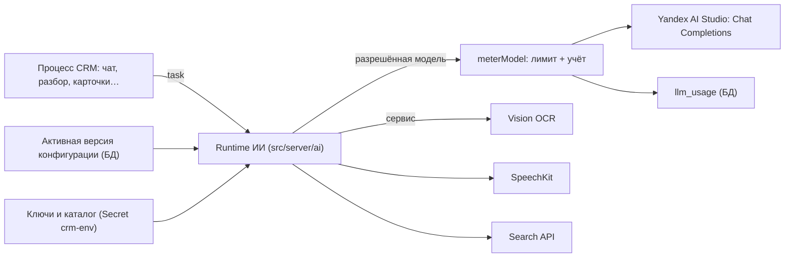
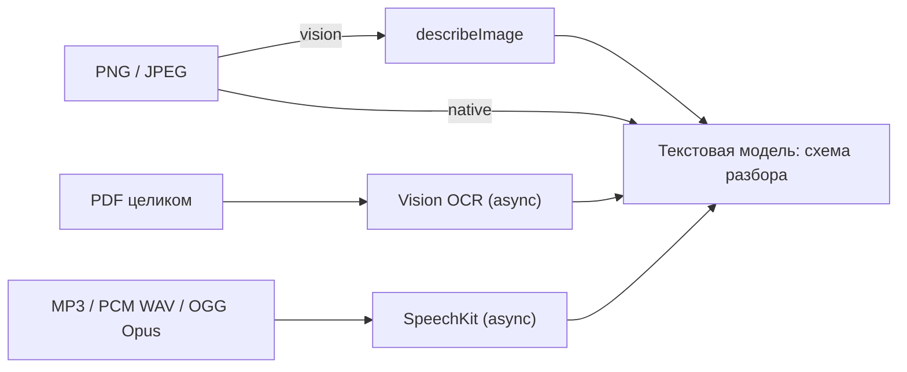

# ИИ-подсистема

Все функции ИИ работают через **Yandex AI Studio** и сервисы Yandex Cloud. Других провайдеров в коде нет: Vercel AI Gateway, Gemini/GPT/Claude и Google Search удалены 11 ноября 2026 года.

Какие модели и сервисы включены и какой процесс какой моделью обслуживается — задаёт **конфигурация маршрутов** в БД, её меняет админ платформы в «Настройки → Модели → Маршруты ИИ» ([ai-configuration.md](ai-configuration.md)). Каждый вызов модели учитывается и ограничивается дневным лимитом ([ai-usage-and-billing.md](ai-usage-and-billing.md)).

## Схема

- **Модели** (`runtime.resolve({ task })`) — генерация текста и структурных ответов, инструменты, потоковый ответ, изображения.
- **Сервисы** (`runtime.service("ocr" | "speech" | "search")`) — REST-операции Yandex. Их результат (текст) передаётся текстовой модели.
- Код процесса не выбирает провайдера и не передаёт строку модели: он называет **процесс** (task), runtime выдаёт разрешённую модель.

## Процессы (tasks)

| ID | Название в UI | Где используется | Требования к модели |
| --- | --- | --- | --- |
| `chat` | ИИ-чат | Глобальный чат (`/api/chat`) | текст, инструменты, потоковый ответ |
| `analytics` | Аналитика: ИИ ассистент | «Аналитика → ИИ ассистент» | текст, инструменты, потоковый ответ |
| `cards` | Карточки Truffalo | Генерация карточек по правилам | текст, структурный ответ |
| `deals` | Поиск сделок | Поиск и обновление сделок по источникам | текст, структурный ответ |
| `orderRequest` | Заказ из запроса | Разбор текста клиента в позиции заказа | текст, структурный ответ |
| `chatSummary` | Итоги чата | Сохранение переписки с ИИ | текст, структурный ответ |
| `companyResearch` | Данные компании: поиск в сети | «Найти в интернете» у компании | текст (+ сервис Search API) |
| `companyExtraction` | Данные компании: извлечение | То же, второй шаг | текст, структурный ответ |
| `parseText` | Разбор: текст | Письма, Google Chat, Telegram, WhatsApp, тексты Drive | текст, структурный ответ |
| `parseOffice` | Разбор: документы Office | DOCX / PPTX после извлечения текста | текст, структурный ответ |
| `parsePdf` | Разбор: PDF | PDF после Vision OCR | текст, структурный ответ (+ OCR) |
| `parseImage` | Разбор: изображения | Изображения | текст, структурный ответ (+ изображения в режиме `native`) |
| `describeImage` | Описание изображений | Описание изображения vision-моделью (режим `vision`) | текст, изображения |
| `parseAudio` | Разбор: аудио | Аудио после SpeechKit | текст, структурный ответ (+ SpeechKit) |
| `parseVideo` | Разбор: видео | Не поддерживается Yandex; включить нельзя | — |
| `orgAttribution` | Разбор: автор сообщения | Определение «своя организация / внешний» | текст, структурный ответ |
| `webSearch` | Веб-поиск | Инструмент `searchWeb` в чате | текст (+ Search API) |

Требования к модели задаёт код ([registry.ts](../../src/server/ai/registry.ts)); их нельзя ослабить настройкой. Модель без нужных возможностей не попадает в список процесса.

## Модели

Модель в конфигурации — внутренний ID (например `yandex-text`, `yandex-vision`), название, **URI Yandex** (`gpt://<каталог>/<модель>`), возможности и признак «включена». URI должен принадлежать каталогу `YANDEX_AI_FOLDER_ID`. Возможности: `text`, `structuredOutput`, `tools`, `streaming`, `image`.

Подключение к Yandex ([adapters/yandex.ts](../../src/server/ai/adapters/yandex.ts), [yandex-connection.ts](../../src/server/ai/yandex-connection.ts)):

- Адрес: `${YANDEX_AI_API_URL}/v1/chat/completions`; по умолчанию `https://ai.api.cloud.yandex.net`. Только этот адрес, редиректы запрещены.
- Заголовки: `Authorization: Api-Key <YANDEX_AI_API_KEY>`, `OpenAI-Project: <YANDEX_AI_FOLDER_ID>`, `x-data-logging-enabled: false`.
- Файлы во входе модели — только inline PNG/JPEG до 10 МиБ и только у моделей с `image`. Ссылки на файлы, PDF, аудио и видео во вход модели не принимаются; AI SDK не скачивает удалённые файлы.
- Автоматического перехода на другую модель или провайдера при ошибке нет.

## Сервисы Yandex

| Сервис | Включение | Ключ | Адрес |
| --- | --- | --- | --- |
| Vision OCR (PDF) | `services.ocr` | `YANDEX_OCR_API_KEY` | `${YANDEX_AI_API_URL}/ocr/v1/…` |
| SpeechKit (аудио, микрофон) | `services.speech` | `YANDEX_SPEECH_API_KEY` | `stt.api.cloud.yandex.net/stt/v3/…` |
| Search API (веб-поиск, данные компаний) | `services.search` | `YANDEX_SEARCH_API_KEY` | `searchapi.api.cloud.yandex.net/v2/web/search` |

Статус асинхронных операций — `operation.api.cloud.yandex.net`. Набор операций фиксирован в [services.ts](../../src/server/ai/services.ts); каталог общий (`YANDEX_AI_FOLDER_ID`). Ключ модели сервисам не передаётся.

## Обработка файлов (Источники)

| Формат | Путь | Ограничения |
| --- | --- | --- |
| Изображения | `files.images = vision`: описание vision-моделью, затем структурирование; `native`: изображение сразу модели `parseImage` | PNG / JPEG, до 10 МиБ |
| PDF | Vision OCR → текст по страницам → текстовая модель | до 10 000 000 байт, `files.pdfMaxPages` (1–20, по умолчанию 10), текст до 120 000 символов. Картинки и диаграммы внутри PDF не анализируются |
| Аудио | SpeechKit → реплики с таймкодами → текстовая модель | WAV (16-bit PCM), MP3, OGG Opus; до 10 МиБ; `files.maxMediaSeconds` (1–600, по умолчанию 180). M4A / WebM / FLAC / OGG Vorbis отклоняются. Говорящие не различаются (`Unknown`) |
| Видео | Не поддерживается | Задачу `parseVideo` включить нельзя |
| Office | Извлечение текста в коде → `parseOffice` | без изменений |

Происхождение результата пишется в `source_item.parser_model`, например `vision-ocr/page → gpt://…`. Длительность и число страниц, превышающие лимит, проверяются после ответа сервиса: такой вызов может быть оплачен, хотя результат отклоняется.

## Веб-поиск и данные компаний

- **Чат**: инструмент `searchWeb` ([web-search.ts](../../src/server/web-search.ts)) регистрируется, если включены функция `webSearch` и процесс `webSearch`. Он вызывает `researchYandex` ([search.ts](../../src/server/ai/search.ts)): Search API (до 6 документов) → модель пишет выводы **только по сниппетам** и ссылается на их URL. Ошибка поиска не обрывает ответ чата: возвращается `grounded: false`.
- **«Найти в интернете» у компании** (`lookupClientOnWeb` в [clients.ts](../../src/server/clients.ts)): шаг 1 — тот же поиск (`companyResearch`), шаг 2 — структурные кандидаты (`companyExtraction`). Чтение сайта компании — отдельная функция `websiteFetch` (сейчас выключена).
- Без сервиса Search API веб-поиск и исследование компаний недоступны. Запасного поиска нет.

## Чат

- Модели чата — из каталога `GET /api/ai/config` (только ID, названия, возможности; без адресов и ключей) через хук `useAiModels`. Сервер повторно проверяет выбранную модель.
- Файлы в чате выключены: сервер отклоняет сообщения с файлами, в том числе в истории (`assertChatContentAllowed`). Кнопки вложений нет. Файлы обрабатываются через Источники.
- Голосовой ввод: функция `serverSpeechRecognition` + SpeechKit. Браузер записывает PCM WAV (AudioWorklet), `POST /api/ai/transcribe` (только после входа), до 90 секунд; текст вставляется в поле ввода. Голосовой ввод средствами браузера (`browserSpeechRecognition`) выключен.

## Ошибки и отключения

| Ситуация | Что видит пользователь / код |
| --- | --- |
| Процесс выключен или модель не разрешена | `AiPolicyError`; функция недоступна, другой модели не вызывается |
| Дневной лимит организации исчерпан | `AiBudgetError`: «Дневной лимит расходов на ИИ для организации исчерпан…»; фоновый разбор переносится на следующий запуск |
| Ошибка Yandex (HTTP, сеть, таймаут) | `AiProviderError` с безопасным текстом; в логах нет ключей и содержимого |
| Нет рабочей конфигурации (нет версии, неверная версия, нет ключа) | ИИ выключен целиком, остальная CRM работает — [ai-configuration.md](ai-configuration.md) |

## Код

Основной код — `src/server/ai/`. Подробная карта файлов: [docs/ai/architecture.md](../ai/architecture.md).

| Файл | Назначение |
| --- | --- |
| [config.ts](../../src/server/ai/config.ts) | Список процессов, возможностей, функций; схема документа конфигурации (версия 2) |
| [resolve.ts](../../src/server/ai/resolve.ts) | Runtime: проверка конфигурации и env, выдача модели и сервисов, текущий runtime процесса |
| [policy.ts](../../src/server/ai/policy.ts), [registry.ts](../../src/server/ai/registry.ts) | Разрешение модели для процесса, обязательные возможности, запрет файлов в чате |
| [media.ts](../../src/server/ai/media.ts), [ocr.ts](../../src/server/ai/ocr.ts), [av.ts](../../src/server/ai/av.ts), [speech.ts](../../src/server/ai/speech.ts), [voice.ts](../../src/server/ai/voice.ts) | Обработка изображений, PDF, аудио, микрофона |
| [search.ts](../../src/server/ai/search.ts) | Search API → выводы по сниппетам |
| [usage.ts](../../src/server/ai/usage.ts) | Обёртка учёта и лимита для каждой модели |
