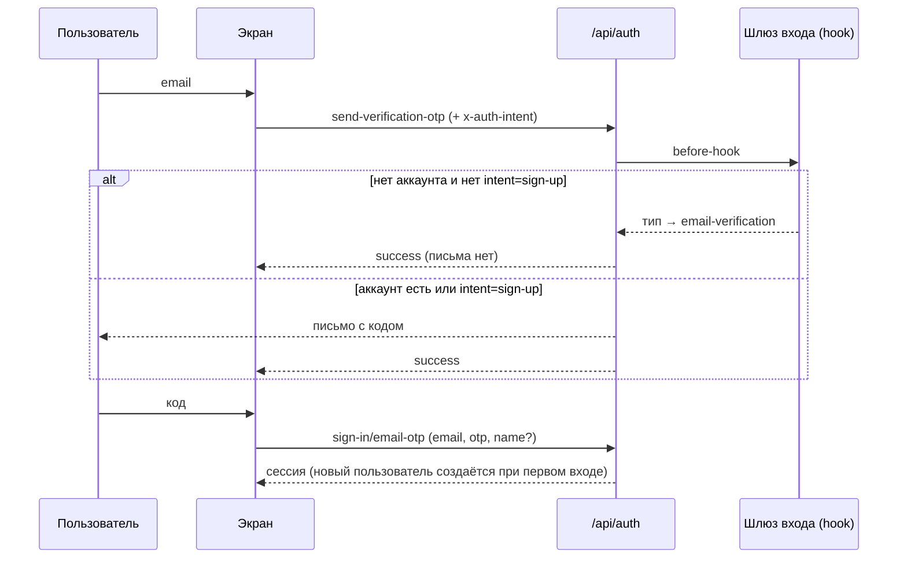

# Вход и регистрация

Вход и регистрация — **только по email и одноразовому коду** из письма. Паролей нет. Входа через Google и GitHub нет (удалены 11 ноября 2026 года).

## Экраны

| Адрес | Экран | Шаги |
| --- | --- | --- |
| `/sign-in` | «Вход» | Email → «Получить код» → 6 цифр из письма → «Войти» |
| `/sign-up` | «Регистрация» | Имя и email → «Получить код» → 6 цифр → «Создать аккаунт» |
| `/accept-invitation/<id>` | «Вас пригласили» | Email задан приглашением. Новый пользователь вводит имя; существующий — только получает код. После кода приглашение принимается |
| `/sign-in/otp` | — | Старый адрес; перенаправляет на `/sign-in` |
| `/forgot-password` | — | Удалён (404): паролей нет |

Общие правила экрана кода ([otp-code-step.tsx](../../src/components/forms/otp-code-step.tsx)):

- Код из 6 цифр, действует **5 минут**, **3 попытки** ввода. Шестая цифра отправляет форму сама.
- «Отправить код повторно» — новый код (старый перестаёт действовать).
- «Изменить email» / «Изменить данные» — назад к первому шагу.
- Ошибки на русском: «Неверный код», «Срок действия кода истёк…», «Слишком много попыток…», «Слишком много запросов…».

После входа — переход на `/dashboard` или на адрес из параметра `?redirect=` (или старого `?callbackURL=`). Принимаются только пути этого сайта (`/…`); внешние адреса заменяются на `/dashboard`.

## Как работает

Основа — плагин `emailOTP` библиотеки better-auth ([src/lib/auth.ts](../../src/lib/auth.ts)). Все экраны используют один тип кода — `sign-in`.

### Вход не создаёт аккаунты

Плагин работает в режиме «регистрация разрешена» (`disableSignUp: false`): первый правильный код для нового email создаёт пользователя. Чтобы экран «Вход» не создавал аккаунты, работает шлюз [auth-otp-gate.ts](../../src/lib/auth-otp-gate.ts) (`hooks.before`):

- Запрос кода **без** заголовка `x-auth-intent: sign-up` для **несуществующего** email не отправляет письмо. Ответ тот же — `{ success: true }`.
- Поэтому экран «Вход» **не показывает, есть ли аккаунт** с этим email: текст всегда «Если аккаунт с адресом … есть, мы отправили код».
- «Регистрация» и страница приглашения отправляют `x-auth-intent: sign-up`. Это удобство интерфейса, а не защита: зарегистрироваться может любой.
- Технически шлюз меняет тип запроса на `email-verification`; для неизвестного email better-auth сам отвечает «успешно» и ничего не отправляет. (Свой ответ из hook вернуть нельзя: better-auth копирует в него заголовки запроса, и браузер отбрасывает ответ.)

### Имя пользователя

- «Регистрация» и приглашение передают имя вместе с кодом. Для существующего аккаунта имя игнорируется.
- Если имени нет, оно берётся из email (часть до `@`): `withFallbackName` в `auth-otp-gate.ts`.

### Организация нового пользователя

Без изменений: при создании пользователя (`databaseHooks.user.create.after`) создаётся организация «Моя организация» — **кроме** случая, когда на этот email есть действующее приглашение. Тогда пользователь попадает в организацию приглашения. Экран «Регистрация» проверяет приглашения до отправки кода (`GET /api/invitations/check`) и предлагает перейти по ссылке из письма.

### Приглашения

[accept-invitation-content.tsx](../../src/app/(auth)/accept-invitation/[id]/accept-invitation-content.tsx):

- Не вошёл → форма `JoinByCode`: email из приглашения (не меняется), имя — только если аккаунта нет (`PublicInvitation.hasAccount`, считается на сервере в [invitations.ts](../../src/server/invitations.ts)). Код → вход/регистрация → `acceptInvitation` → `setActive` → `/dashboard`.
- Вошёл с тем же email → кнопка «Принять приглашение».
- Вошёл с другим email → «Не тот аккаунт» и «Выйти».

## Что удалено и что осталось

| Удалено | Где было |
| --- | --- |
| Вход по паролю, регистрация с паролем, «Забыли пароль?», «Сменить пароль» в профиле | формы, `emailAndPassword` в `auth.ts` |
| Админ: «Задать пароль» пользователю | таблица пользователей в «Настройки» |
| Вход через Google и GitHub, плагин `oAuthProxy` | `socialProviders` в `auth.ts` |

Эндпоинты паролей и OAuth отвечают ошибкой (`EMAIL_PASSWORD_DISABLED`, `PROVIDER_NOT_FOUND`, `RESET_PASSWORD_DISABLED`).

Осталось:

- Подтверждение email по ссылке (`emailVerification`): используется, когда админ меняет email пользователю в профиле («Отправить письмо для подтверждения»). Вход по коду сам отмечает email подтверждённым.
- Старые пользователи с паролем или OAuth-аккаунтом входят по коду на тот же email. Строки `account` с паролями / OAuth остаются в БД и не используются.

## Защита

- Код хранится в таблице `verification` открытым текстом (настройка плагина по умолчанию), живёт 5 минут, после 3 неверных попыток недействителен.
- Ограничение частоты (в production): не более 3 запросов кода в минуту с одного IP-адреса; проверку кода ограничивают 3 попытки на код и общий лимит better-auth. Счётчики хранятся в памяти процесса, у каждой реплики свои.
- Перебор кода не раскрывает наличие аккаунта: для неизвестного email кода просто нет.
- Письма отправляет `sendEmails` ([src/lib/email.ts](../../src/lib/email.ts)), провайдер — `EMAIL_PROVIDER` (Nylas по умолчанию или Resend). Тема «Ваш код для входа».

## Файлы

| Файл | Назначение |
| --- | --- |
| [src/lib/auth.ts](../../src/lib/auth.ts) | Конфигурация better-auth: emailOTP, шлюз, hooks пользователя/сессии/организации, приглашения |
| [src/lib/auth-otp-gate.ts](../../src/lib/auth-otp-gate.ts) | Шлюз «вход не создаёт аккаунты», имя по умолчанию |
| [src/lib/auth-intent.ts](../../src/lib/auth-intent.ts) | Заголовок `x-auth-intent` (общий для сервера и клиента) |
| [src/lib/auth-otp-client.ts](../../src/lib/auth-otp-client.ts) | Клиент: отправка и проверка кода, русские ошибки, безопасный `redirect` |
| [src/components/forms/otp-code-step.tsx](../../src/components/forms/otp-code-step.tsx) | Общий шаг ввода кода |
| [form-sign-in.tsx](../../src/components/forms/form-sign-in.tsx), [form-sign-up.tsx](../../src/components/forms/form-sign-up.tsx) | Экраны входа и регистрации |

## Настройки

Переменные: `BETTER_AUTH_SECRET`, `BETTER_AUTH_URL`, `EMAIL_PROVIDER` и ключи почтового провайдера (`NYLAS_*` или `RESEND_*`). `GOOGLE_CLIENT_*` и `GITHUB_CLIENT_*` больше не читаются — их можно удалить из `crm-env` и `.env`.
